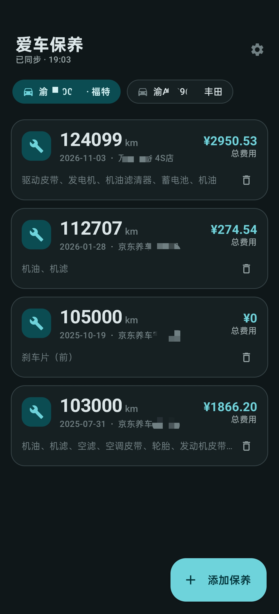
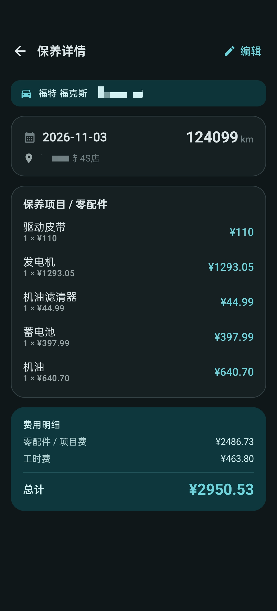
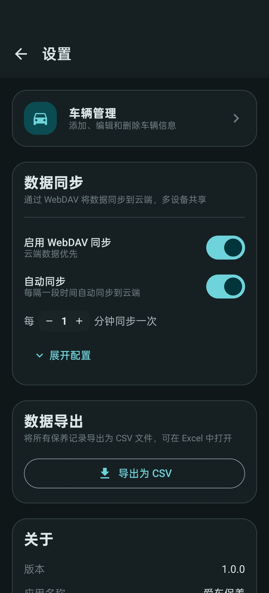

# 爱车保养 · Car Maintenance

一款简洁的 Android 汽车保养记录应用：本地优先、无广告、支持 WebDAV 云端同步。

A local-first car maintenance tracker for Android: no ads, no account required, with optional WebDAV cloud sync.

## 截图 · Screenshots

<p>
  
  
  
</p>

## 功能 · Features

- 🚗 **多车辆管理** — 车牌、品牌型号、购入日期，长按拖动排序，主页标签页联动
- 🔧 **保养记录** — 日期、里程、保养地点、备注，零配件按「单价 × 数量」或「总价」两种模式录入
- 💰 **费用统计** — 自动汇总配件费与工时费，详情页展示费用明细
- ☁️ **WebDAV 同步** — 支持坚果云等 WebDAV 网盘，云端数据优先，可配置自动同步间隔，首页显示上次同步状态
- 📤 **CSV 导出** — 一键导出全部记录，可在 Excel 中打开
- 🔒 **本地优先** — 所有数据存储在本地 Room 数据库，无注册、无追踪

---

- 🚗 **Multi-vehicle management** — plate number, brand, purchase date, drag to reorder
- 🔧 **Maintenance records** — date, mileage, shop, notes; parts priced by unit×quantity or total
- 💰 **Cost summary** — automatic totals for parts and labor
- ☁️ **WebDAV sync** — cloud-first sync (e.g. Nutstore), configurable auto-sync interval, last-sync status on home
- 📤 **CSV export** — export all records for Excel
- 🔒 **Local-first** — all data stays in a local Room database; no sign-up, no tracking

## 技术栈 · Tech Stack

| 层 Layer | 技术 Technology |
| --- | --- |
| UI | Jetpack Compose · Material 3 |
| 架构 Architecture | MVVM · Repository · Flow |
| 数据 Data | Room (SQLite) · SharedPreferences |
| 同步 Sync | WebDAV (OkHttp PROPFIND/PUT/GET) · 事务化导入 |
| 语言 Language | Kotlin |

- minSdk 26 · targetSdk 35
- 包名 Package：`com.carmaintenance.app`

## 构建 · Build

```bash
./gradlew assembleDebug      # 调试版 Debug APK
./gradlew assembleRelease    # 发布版 Release APK
```

或直接前往 [Releases](../../releases) 下载编译好的 APK。
Or grab a pre-built APK from [Releases](../../releases).

## 许可证 · License

[MIT](LICENSE) © 2026 HANCAO
